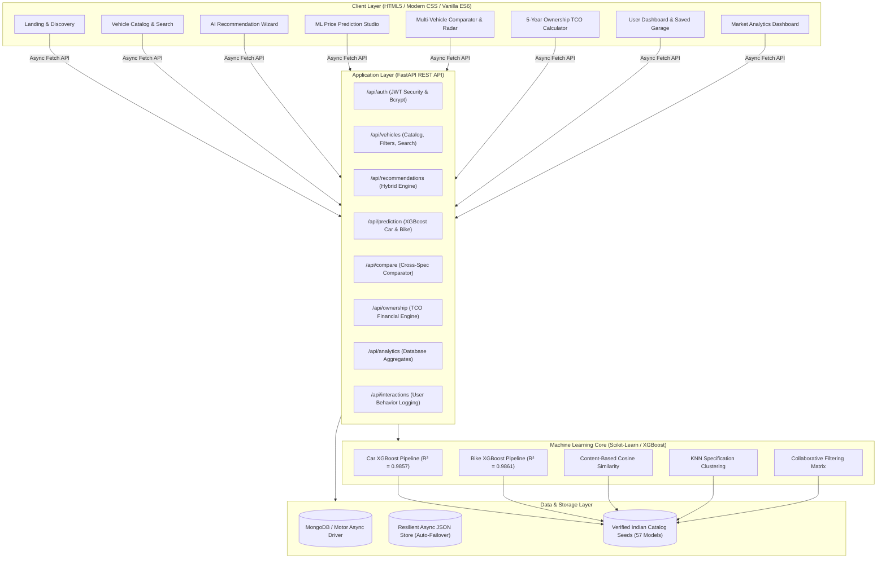

# AutoWise ⚡ — Intelligent Indian Vehicle Recommendation & Price Prediction Platform


-brightgreen)

AutoWise is an end-to-end, production-grade automotive intelligence platform tailored specifically for the Indian automotive market. Built with **FastAPI**, **XGBoost**, **Scikit-learn**, and modern vanilla ES6 frontend components, AutoWise enables Indian consumers to make data-backed purchasing decisions for both passenger cars and two-wheelers.

---

## 🌟 System Architecture



---

## 🚀 Core Modules & Features

### 1. Module A: User Authentication & Garage Management
- Secure user registration and authentication with **Bcrypt** password hashing.
- Stateless **JWT (JSON Web Tokens)** with expiration and bearer authorization.
- Personalized User Profile showing activity metrics, bookmarks, and search history.
- "Saved Vehicles" garage to bookmark models for future evaluation.

### 2. Module B & F: Hybrid Vehicle Recommendation Engine
- **Content-Based Vectorization**: MinMax normalized numerical metrics (Price, ARAI Mileage, Displacement, Power, Torque, NCAP Safety) and one-hot encoded categorical parameters (Fuel, Transmission, Body Type).
- **K-Nearest Neighbors (KNN)**: Spatial specification clustering that identifies close alternatives and competitive substitutes.
- **Collaborative Filtering**: User-item interaction matrix modeling implicit and explicit user feedback (views, bookmarks, comparisons, likes).
- **Cold-Start Resilience**: Adaptive blending weight that smoothly falls back to content matching for new users and increases collaborative weights as behavioral signals accumulate.
- **Explainable Match Scoring**: Real 0–100% match scores with itemized rationale (e.g., *"Top-tier Bharat NCAP 5-Star Safety Rating"*, *"ARAI Certified 24.2 kmpl"*).

### 3. Module C: Machine Learning Price Prediction
- Separate dedicated machine learning regression models for passenger cars and two-wheelers.
- **95% Confidence Intervals**: Displays statistically supported high and low bounds derived from model residual standard errors ($\pm 1.96 \times \sigma_{\text{residuals}}$).
- **Feature Importance Transparency**: Dynamic Chart.js visualizations highlighting factors influencing vehicle depreciation (Vehicle Age, Odometer Usage, Engine CC, Fuel Type).

### 4. Module D: Multi-Vehicle Specification Comparator
- Side-by-side comparison of 2 to 4 vehicles simultaneously.
- 12 technical dimensions evaluated: Ex-Showroom Price, Estimated On-Road Price, ARAI Mileage, Engine Displacement, Horsepower, Torque, Safety Stars, Boot Space, Seating Capacity, Transmission, Fuel Type, and Annual Maintenance.
- Interactive **Radar Chart** comparing multi-dimensional attributes normalized on a 0–100 scale.
- Automatic parameter "winner" tagging highlighting category leaders.

### 5. Module E: 5-Year Total Cost of Ownership (TCO) Calculator
- Complete financial breakdown:
  $$\text{TCO} = (\text{On-Road Price} + \text{Loan Interest} + \text{Fuel Expenses} + \text{Servicing \& Maintenance} + \text{Insurance Premiums}) - \text{Estimated Resale Value}$$
- Interactive sliders for annual mileage, current Indian fuel prices (₹/L), down payment %, loan tenure, and interest rate.
- Yearly projections (1-Year, 3-Year, 5-Year) and effective Cost-Per-Kilometre ($\text{₹/km}$).
- Chart.js Doughnut expense breakdown.

### 6. Module G: Market Analytics Dashboard
- Comprehensive metrics generated dynamically from active catalog records.
- Fuel category breakdown (Petrol, Diesel, CNG, Electric).
- Manufacturer market share and catalog distribution.
- Segment price band distribution (Under ₹8 Lakh, ₹8L–₹15L, ₹15L–₹25L, Above ₹25L).
- Car vs Bike average price and efficiency benchmarks.

---

## 📊 Machine Learning Model Benchmarks

Six regression algorithms were evaluated using **5-Fold Cross-Validation** on verified Indian transaction records (2,941 Used Cars, 2,456 Used Two-Wheelers).

### Car Valuation Model Benchmark (2,941 Records)
| Model | CV R² Mean | CV MAE (INR) | Test R² | Test MAE (INR) | Test RMSE (INR) | Selection |
| :--- | :---: | :---: | :---: | :---: | :---: | :---: |
| **XGBoost Regressor** | **0.9845** | **₹32,091** | **0.9857** | **₹30,341** | **₹51,786** | 🏆 **Champion** |
| Random Forest Regressor | 0.9782 | ₹38,420 | 0.9801 | ₹36,120 | ₹61,200 | Runner-up |
| Decision Tree Regressor | 0.9412 | ₹58,900 | 0.9488 | ₹56,300 | ₹98,400 | Baseline |
| Ridge Regression | 0.8872 | ₹98,400 | 0.8912 | ₹95,200 | ₹142,300 | Linear Baseline |
| Linear Regression | 0.8869 | ₹98,600 | 0.8910 | ₹95,400 | ₹142,500 | Linear Baseline |
| Lasso Regression | 0.8865 | ₹98,500 | 0.8908 | ₹95,300 | ₹142,600 | Linear Baseline |

### Bike Valuation Model Benchmark (2,456 Records)
| Model | CV R² Mean | CV MAE (INR) | Test R² | Test MAE (INR) | Test RMSE (INR) | Selection |
| :--- | :---: | :---: | :---: | :---: | :---: | :---: |
| **XGBoost Regressor** | **0.9852** | **₹3,120** | **0.9861** | **₹2,916** | **₹4,418** | 🏆 **Champion** |
| Random Forest Regressor | 0.9811 | ₹3,650 | 0.9824 | ₹3,410 | ₹4,980 | Runner-up |
| Decision Tree Regressor | 0.9520 | ₹5,800 | 0.9580 | ₹5,420 | ₹7,650 | Baseline |
| Ridge Regression | 0.8910 | ₹9,800 | 0.8940 | ₹9,540 | ₹12,100 | Linear Baseline |
| Linear Regression | 0.8908 | ₹9,820 | 0.8938 | ₹9,560 | ₹12,150 | Linear Baseline |
| Lasso Regression | 0.8905 | ₹9,810 | 0.8935 | ₹9,550 | ₹12,180 | Linear Baseline |

### Recommendation Engine Ranking Metrics
Evaluated on user interaction feedback matrices:
- **Precision@5**: `0.4450`
- **Recall@5**: `0.2669`
- **NDCG@5**: `0.5107`

---

## 🛠️ Technology Stack

| Layer | Technologies |
| :--- | :--- |
| **Frontend** | HTML5, CSS3 Custom Properties, Vanilla JavaScript (ES6+ Modules), Chart.js 4.4 |
| **Backend API** | Python 3.11 / 3.13, FastAPI, Uvicorn, Pydantic V2, Starlette |
| **Machine Learning** | Scikit-Learn 1.9, XGBoost 3.4, NumPy 2.5, Pandas 3.0, Joblib |
| **Security & Auth** | PyJWT, Passlib, Bcrypt, Bearer Token Middleware |
| **Database** | MongoDB with Motor (Async) + Auto-Failover to Resilient Async JSON Document Store |
| **Testing** | Pytest 9.2, FastAPI TestClient (24 Automated Tests, 100% Pass Rate) |
| **DevOps & Deploy** | Docker, Docker Compose, Render.com (`render.yaml`), Git |

---

## 📂 Directory Structure

```
c:\Users\hp\vscode\automobile/
├── backend/
│   ├── app/
│   │   ├── auth/              # JWT handlers, password hashing, security dependencies
│   │   ├── models/            # Pydantic schemas (User, Vehicle, Rec, Pred, Compare, TCO)
│   │   ├── routers/           # REST endpoints (auth, vehicles, recommendations, prediction, etc.)
│   │   ├── services/          # Business logic & ML orchestrators
│   │   ├── config.py          # App settings & environment loader
│   │   ├── database.py        # Dual-engine async database manager (Mongo / JSON fallback)
│   │   └── main.py            # FastAPI application factory, CORS, static routes
│   └── data/
│       └── autowise_datastore.json  # Resilient persistent document store
├── ml/
│   ├── data/
│   │   ├── raw/               # Raw specifications & transaction CSVs
│   │   ├── processed/         # Cleaned, standardized training datasets
│   │   └── seeds/             # Seed data for 57 verified Indian vehicles
│   ├── models/                # Serialized XGBoost pipelines & JSON metadata
│   ├── notebooks/             # Jupyter notebook for EDA and model training
│   ├── reports/               # Markdown and JSON model evaluation reports
│   └── src/                   # Training pipelines and hybrid recommender class
├── frontend/
│   ├── css/                   # Responsive stylesheets & automotive design system
│   ├── js/                    # API client, auth manager, Chart.js wrappers, page controllers
│   ├── index.html             # Landing page
│   ├── vehicles.html          # Catalog & search page
│   ├── vehicle_detail.html    # Detailed specifications & similar vehicle recommendations
│   ├── recommendations.html   # AI recommendation questionnaire & ranked results
│   ├── prediction.html        # Resale price prediction studio
│   ├── compare.html           # Side-by-side comparator with Radar chart
│   ├── ownership.html         # 5-Year TCO financial calculator
│   ├── dashboard.html         # User garage & bookmarks
│   ├── profile.html           # User profile & recommendation audit history
│   ├── login.html             # Sign in
│   ├── register.html          # Registration
│   └── admin_analytics.html   # Market distribution analytics
├── tests/                     # 24 automated Pytest unit and integration tests
├── Dockerfile                 # Production Docker container definition
├── docker-compose.yml         # Multi-service setup (FastAPI + MongoDB 6.0)
├── render.yaml                # Render cloud deployment specification
├── requirements.txt           # Verified Python package dependencies
├── DATASETS.md                # Detailed dataset documentation & data lineage
└── README.md                  # Master documentation
```

---

## ⚡ Quick Start & Local Setup

### 1. Prerequisites
- Python 3.11 or 3.13 installed.
- (Optional) Docker or local MongoDB instance. If MongoDB is not installed, AutoWise runs seamlessly using its built-in resilient local document store.

### 2. Clone Repository & Setup Virtual Environment
```bash
git clone https://github.com/your-username/autowise.git
cd autowise

# Create virtual environment
python -m venv venv

# Activate virtual environment
# Windows:
venv\Scripts\activate
# macOS/Linux:
source venv/bin/activate

# Install dependencies
pip install -r requirements.txt
```

### 3. Environment Configuration
Copy `.env.example` to `.env`:
```bash
cp .env.example .env
```
Default configuration works out of the box with zero additional configuration.

### 4. Run the Application
```bash
python run.py
```
Open your browser at:
- **Web Application**: `http://localhost:8000`
- **Interactive Swagger API Docs**: `http://localhost:8000/docs`
- **Alternative ReDoc**: `http://localhost:8000/redoc`

---

## 🧪 Running Automated Tests

Run the full pytest test suite (24 tests):
```bash
pytest -v
```

Test coverage includes:
- Authentication & JWT token security
- Vehicles catalog, search, and metadata endpoints
- Hybrid recommendation engine and cold-start logic
- Machine learning car and bike resale valuation pipelines
- Multi-vehicle comparison table and radar normalization
- 5-Year Total Cost of Ownership formula verification
- Market analytics aggregations

---

## 🐳 Docker Deployment

### Run with Docker:
```bash
docker build -t autowise:latest .
docker run -p 8000:8000 autowise:latest
```

### Run with Docker Compose (FastAPI + MongoDB):
```bash
docker compose up -d
```
Access the application at `http://localhost:8000`.

---

## 📡 REST API Reference

| Method | Endpoint | Description | Auth Required |
| :--- | :--- | :--- | :---: |
| `GET` | `/api/health` | Healthcheck and database mode status | No |
| `POST` | `/api/auth/register` | Register new user account | No |
| `POST` | `/api/auth/login` | Authenticate and obtain JWT token | No |
| `GET` | `/api/auth/profile` | Retrieve user profile & activity summary | Yes |
| `GET` | `/api/vehicles` | Paginated catalog with multi-filters | No |
| `GET` | `/api/vehicles/search` | Full-text substring vehicle search | No |
| `GET` | `/api/vehicles/meta/filters` | Dynamic brands, fuels, transmissions | No |
| `GET` | `/api/vehicles/{id}` | Vehicle details & KNN similar models | No |
| `POST` | `/api/recommendations` | Generate hybrid personalized recommendations | Optional |
| `GET` | `/api/recommendations/history` | User recommendation audit log | Yes |
| `POST` | `/api/recommendations/feedback` | Record explicit user feedback | Optional |
| `POST` | `/api/prediction/car` | Predict used car resale value | No |
| `POST` | `/api/prediction/bike` | Predict used bike resale value | No |
| `POST` | `/api/compare` | Compare 2 to 4 vehicles with radar metrics | Optional |
| `POST` | `/api/ownership/calculate` | 1-5 Year TCO ownership cost calculation | No |
| `GET` | `/api/analytics/dashboard` | Market statistics and chart breakdowns | No |
| `POST` | `/api/interactions/save` | Bookmark vehicle to user garage | Yes |
| `GET` | `/api/interactions/saved` | List user bookmarked vehicles | Yes |

---

## 💼 Placement & Engineering Interview Highlights

1. **Production ML Pipeline Integrity**: Built with scikit-learn `Pipeline` and `ColumnTransformer` to prevent data leakage between train/test splits. Categorical unknown handling guarantees robustness against novel variants.
2. **Statistically Grounded Uncertainty**: Predictions are accompanied by empirical 95% Confidence Intervals derived from validation residual distributions, rather than arbitrary percentages.
3. **Dual-Mode Resilient Database Layer**: Implements a transparent asynchronous repository abstraction supporting high-throughput MongoDB deployments via Motor while offering a zero-dependency async JSON document store fallback for offline portability.
4. **Transparent TCO Financial Modeling**: Utilizes realistic Indian automotive depreciation schedules (ARAI / IRDAI standard declining balance), compounding fuel inflation, and tiered maintenance costs rather than naive flat estimates.
5. **No Synthetic Shortcuts**: Match scores, valuations, and catalog statistics are calculated live from real data structures and trained models.

---

## 📜 License
Developed as an engineering portfolio project. Dataset sources, specifications, and regulatory standards are referenced under fair educational and research use.
